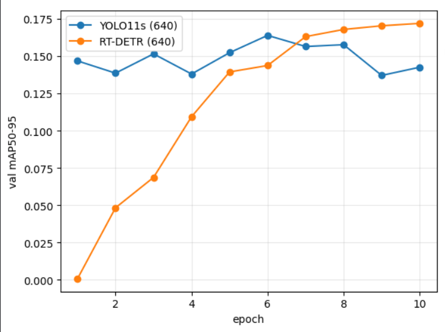
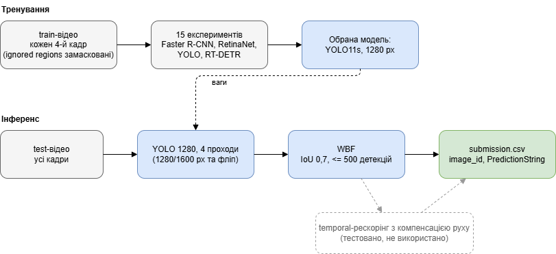
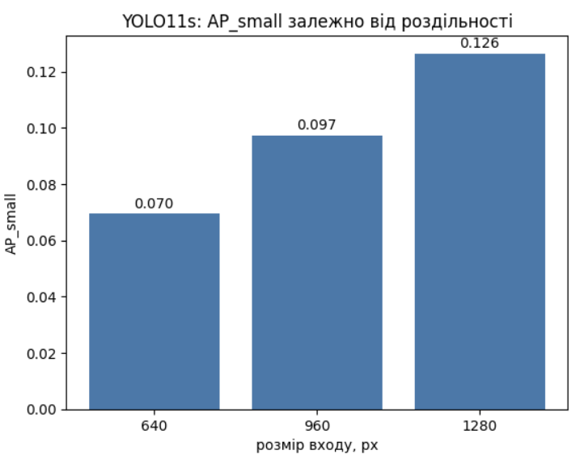
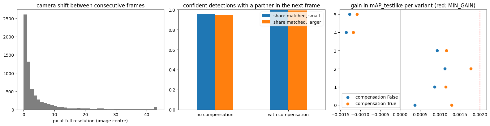
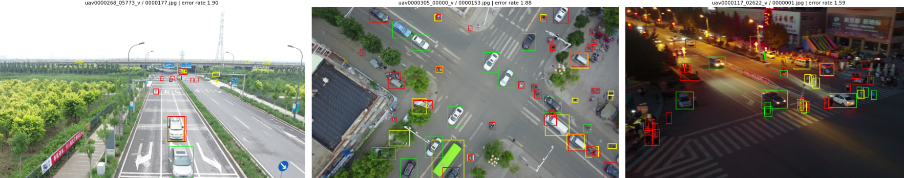
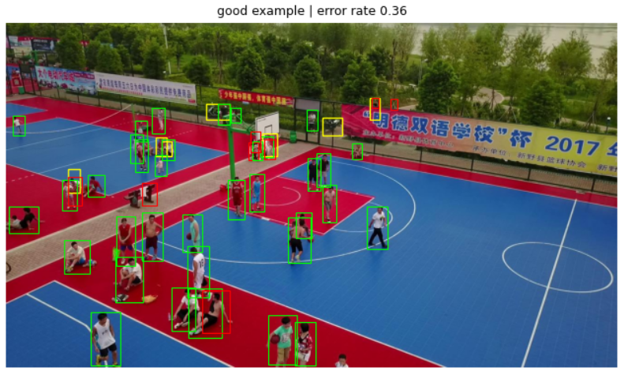

## Introduction

Перед нами стоїть задача object detection з відео, котрі знімалися із дронів, – визначаємо ЩО САМЕ, ДЕ. На вхід моделям дається один кадр з відео різних розмірів. Моделі обробляють кожен кадр окремо, сусідні кадри не потрібні. Вихід: список детекцій кадру – клас, bounding box (рамка з координатами, де є цей об’єкт); впевненість по шкалі [0;1].

Розмір train 56 відео, validation 7, test 48. Усього 8 класів. Різні розміри кадрів. Сцени щільні(5-180 об’єктів за кадр), дрібні(25% у train менші за 32 px), дисбаланс класів(car 46%, person 30%, bus 0,9%). Сусідні кадри майже однакові, тому беремо кожен 4-ий кадр(об’єкт зсувається тільки на 17%), загалом 6072 кадрів. Дані розділені по відео, щоб не було витоку даних. Використовую COCO-анотацію, ігноровані зони займають 2.4% площі кадру, є в 75% train-кадрів.

Головна метрика – COCO mAP@[.5:.95]. Вважаємо детекцію правильною, якщо клас збігається з GT і IoU з рамкою GT не менше за поріг. Сортуємо детекції за score, будуємо криву precision-recall, AP – площа під нею. mAP – середнє AP по 10 порогах IoU (0,50; ... 0,95) і 8 класах. AP50 показує, чи модель взагалі знаходить об'єкти. AP75 вимагає точнішої рамки. AP_small / AP_medium / AP_large для різних за площею.

## Method
Порівнювала 4 родини детекторів: two-stage anchor-based (Faster R-CNN), one-stage anchor-based (RetinaNet), anchor-free (YOLO11s) і query-based (RT-DETR). Для кожної родини є baseline і декілька змін(anchors, loss, роздільність, P2-голова, параметри RT-DETR denoising, кількість queries). Порівнювала на однакових даних: 6072 кадри, 10 епох, однакова оцінка (COCO на val), ваги з претрейн, seed 42. Faster R-CNN і RetinaNet: SGD, lr 0,01 і 0,005. YOLO і RT-DETR: AdamW, lr 0,000833. Хотіла з’ясувати, яка родина детекторів краща на цих даних і якою ціною за швидкістю, а також побудувати найкращий пайплайн на основі підбраних налаштувань. Провела 15 експериментів.

| Модель | Що змінила | Чому |
| --- | --- | --- |
| Faster R-CNN base | нічого | baseline |
| Faster R-CNN anch | anchors з KMeans по рамках train | дефолтні anchors починаються з 32 px, багато об'єктів менші |
| Faster R-CNN loss | L1 box loss (beta = 0) | перевірити, чи важить box loss |
| RetinaNet base | нічого | baseline |
| RetinaNet anch | anchors з KMeans | та сама ідея, що й у Faster R-CNN |
| RetinaNet anch2 | дефолтні anchors, поділені на 2 | anch не спрацював (anchors замалі для stride), це виправлення |
| RetinaNet l1 | L1 замість GIoU | перевірити box loss |
| YOLO base | нічого, 640 px | baseline |
| YOLO 960 | вхід 960 px | при 640 9,8% об'єктів менші за 8 px, при 960 лише 1,7% |
| YOLO 1280 | вхід 1280 px | лише 0,6% об'єктів менші за 8 px |
| YOLO p2 | додаткова P2-голова | для дрібних об'єктів |
| YOLO box | вага box loss 12 | перевірити box loss |
| RT-DETR base | нічого, 300 queries | baseline |
| RT-DETR dn | 200 denoising queries | у кадрах до 180 об'єктів, дефолтних 100 замало |
| RT-DETR nq150 | 150 queries | максимум 116 об'єктів на val-кадр, тож 150 має вистачити |

Anchors (Faster R-CNN, RetinaNet). Це стандартні рамки, з яких модель шукає об’єкти. Замість типових розмірів, я підбирала їх з даних: взяла розміри всіх рамок з train, зменшила їх так, як зменшується кадр на вході моделі) і за допомогою k-means знайшла типові розміри. Для Faster R-CNN – 5 розмірів, для RetinaNet – 15. Щоб перевірити, чи anchors підходять, я рахувала coverage: яка частка рамок має хоча б один anchor, достатньо схожий на неї(поріг IoU >=0,5). Для retina_anch на реальній сітці не знайшли пари для 83% рамок через те, що anchors були замалі і модель майже не мала прикладів. У anch2 взяла розміри й поділила на 2(mAP 0,101 проти 0,090). Без RPN детектор одразу розглядає дуже багато кандидатів, і майже всі з них фон. Легкі фонові приклади переважають у loss і заглушають справжні об'єкти. У RetinaNet це виправляє focal loss, а також поріг IoU, за яким anchor вважається позитивним чи негативним.

Loss. Замінила функцію втрат на L1, бо GIoU працює безпосередньо з перекриттям, а L1 на малих боксах чутливіший до абсолютних зсувів.

Роздільність і P2 (YOLO). На 640 px дрібні об'єкти менші за крок сітки, тому збільшила вхід. Додала P2-голову, це мало б допомогти створити детальнішу feature map для дрібних об'єктів, але на mAP не вплинуло. Anchors у YOLO немає: позитивними вибираються клітинки, у яких збігаються висока впевненість класу і хороший IoU з об'єктом. Для малого об'єкта таких клітинок мало, а одна клітинка не може відповідати за два сусідніх об'єкти, тому щільні сцени й дрібні об'єкти даються важко. Перебирала вхід 640/960/1280, вага box loss (стандартна і 12), P2 (з/без).

RT-DETR. 300 запитів покривають максимум 180 об'єктів у кадрі, NMS не потрібен. Кожному справжньому об'єкту призначається рівно один query, решта queries вчаться повідомляти про відсутність. Другий query на тому ж об'єкті штрафується, тож дублікатів немає і NMS не потрібен. На початку парування нестабільне, тому навчання повільне: після 1-ї епохи mAP 0,001 (YOLO 0,147), а крива росла до кінця:

Фінальну модель я вибрала YOLO 1280 з TTA 2 масштаби 1280/1600 та фліп. Злиття проходів за допомогою WBF, IoU 0.7, до 500 детекцій на кадр. ВИбираючи параметри, дивилась на val mAP_testlike. Temporal не додала, бо приріст маленький.

Бонус-частина. Об’єкт з’являється на кількох кадрах підряд, хибна детекція  ~тільки на одному. Тому score рамки коригувала за сусідніми кадрами. Без урахування руху камери приріст – 0,001. Тоді оцінила рух камери й зсунула рамки, а потім порівнювала: частка знайдених пар з 0,958 до 0,997, проте mAP виріс лише на 0,0018, що нижче порога 0,002. У фінал крок не включила.

## Results

| Модель | mAP | AP50 | AP_small | мс/кадр |
| --- | --- | --- | --- | --- |
| YOLO 1280 | 0,221 | 0,418 | 0,126 | 23,7 |
| YOLO 960 | 0,195 | 0,377 | 0,097 | 17,1 |
| YOLO base | 0,167 | 0,318 | 0,07 | 11,8 |
| YOLO p2 | 0,141 | 0,28 | 0,064 | 14,5 |
| RT-DETR dn | 0,193 | 0,365 | 0,066 | 54 |
| RT-DETR base | 0,18 | 0,348 | 0,066 | 56 |
| Faster R-CNN anch | 0,135 | 0,29 | 0,043 | 36,1 |
| Faster R-CNN base | 0,128 | 0,266 | 0,035 | 35,4 |
| RetinaNet anch2 | 0,101 | 0,228 | 0,035 | 27,7 |
| RetinaNet base | 0,09 | 0,183 | 0,031 | 26,3 |
| RetinaNet anch | 0,02 | 0,077 | 0,02 | 30,4 |

| Варіант | Злиття | mAP | AP50 | AP_small | mAP_testlike |
| --- | --- | --- | --- | --- | --- |
| 1 прохід, 1280 | нема | 0,2213 | 0,418 | 0,1263 | 0,2375 |
| 1 прохід, 1600 | нема | 0,2132 | 0,4141 | 0,1302 | 0,2279 |
| фліп | WBF 0,6 | 0,2261 | 0,4304 | 0,1197 | 0,2445 |
| 2 масштаби (1280, 1600) | WBF 0,6 | 0,2281 | 0,4371 | 0,1309 | 0,2411 |
| 2 масштаби + фліп | NMS 0,7 | 0,2322 | 0,4424 | 0,1378 | 0,255 |
| 2 масштаби + фліп | WBF 0,6 | 0,2399 | 0,4572 | 0,1324 | 0,2584 |
| 2 масштаби + фліп | WBF 0,8 | 0,2439 | 0,4516 | 0,1356 | 0,2641 |
| 2 масштаби + фліп | WBF 0,7 (фінал) | 0,2457 | 0,4611 | 0,1366 | 0,2649 |

Найбільше дало поєднання масштабів і фліпа з WBF( mAP зросло з 0,2213 до 0,2457). Оптимальний поріг IoU 0,7, ліміт 500 детекцій краще за 300.

Ліворуч: зсув камери між сусідніми кадрами у px. У центрі: частка впевнених детекцій, для яких знайшлась пара в наступному кадрі, без компенсації руху й з нею. Праворуч: приріст mAP_testlike для кожного варіанта(червона лінія – поріг 0,002, жоден варіант його не досяг).

Приклади поганих детекцій(зелені правильні, червоні хибні, жовте пропущено):

Гарна детекція:

Знайдено правильно 14 050 детекцій, хибних 11 509. Загалом у розмітці 28 685 об'єктів, тож модель пропускає приблизно половину об'єктів. Faster R-CNN аналіз помилок: RPN пропонує області, де може бути об'єкт, а другий етап уточнює рамку й визначає клас, тому якщо RPN пропустив об'єкт, другий етап його вже не поверне. Помилки: фон 45%, хибний клас 30%, неточна рамка 24%, дублікатів лише 2%. На найгірших кадрах далекі дрібні машини, вид зверху і нічна сцена з групою людей, причини я лише припускаю з кадрів.

Роздільність зіграла найбільшу роль і дала найбільший приріст у mAP, AP_small. Збільшивши роздільність у YOLO з 640 до 1280, mAP зріс із 0.167 до 0,221. На 640 майже кожен 10-ий об'єкт менший за 8 px, на 1280 лише 0,6%, але час навчання у 4 рази довше. P2 не допомогло, припускаю, що 10 епох замало, але я це не перевіряла. Anchors допомогли незначно. Loss майже ні на що не вплинув, тільки шум, або навіть погіршення. RT-DETR не встиг навчитись, 150 queries замість 300 нічого не змінили, denoising незначно вплинув у позитивну сторону +0,013. YOLO швидка і точна, RT-DETR повільніша в 5 разів, Faster R-CNN і RetinaNet слабші, якщо судити по mAP. Найбільше допомогли TTA та WBF (0,2213 – 0,2457). Temporal-крок дав лише 0,0018, у фінал не зараховувала. Усі запуски по одному разу й по 10 епох, тому різниці до ~0,005 mAP не варто вважати значущими.

## Conclusion

Найкращим пайплайном виявився YOLO11s на вході з роздільністю 1280 px з TTA (масштаби 1280/1600, фліп) і злиттям через WBF (IoU 0,7). На val він дає mAP 0,2457 (один прохід без TTA дає 0,2213). Бал на лідерборді: 0.2232775040.

Найбільше спрацювало збільшення роздільності, це допомогло підняти mAP, mAP_small, а також TTA, WBF. Anchors з KMeans допомогли Faster R-CNN, у RetinaNet вони спочатку зламали навчання, і це виправила, поділивши стандартні розміри на 2.

Не спрацювали P2, зміни loss і temporal-рескорінг (підвищення нижче порогу 0.002).

Обмеження: Усі моделі навчались лише на 10 епох, я читала, що для більш-менш якісного навчання потрібно ~100 епох. RT-DETR не встиг збігтись. Варіанти RT-DETR з окремим lr, matching cost, 960 px і tuned я не запускала. Що тягне нас донизу, це дрібні об’єкти, а особливо, якщо вони щільно розташовані, в наших відео це часта історія: AP_small 0,137 проти mAP 0,246. TTA потребує 4 проходів, тож інференс повільніший. Val і test мають різні набори роздільностей.

Далі можна спробувати навчання ще на більшій роздільності – 1600 рх для того, щоб покращити AP_small. Також можна брати кожен 2-ий кадр, замість кожного 4-ого, так буде втрачатись менше даних. А ще цікаво було б спробувати ансамбль різних моделей, наприклад, YOLO та RT-DETR, зливши їх через WBF.

Як відтворити. Усе запускалось на Kaggle (GPU, Internet On, змагання додане як Input), seed 42 скрізь, залежності в requirements.txt (у ноутбуках додатково ставиться лише ultralytics).

01_training.ipynb: у клітинці Config RUN = ["yolo_1280"], SMOKE = False, потім Save & Run All. Дає ваги runs/yolo_1280/weights/best.pt, метрики й детекції на val.

02_inference.ipynb, MODE = "infer" (GPU, ~30 хв): Input це змагання й результат кроку 1. Дає сирі детекції кожного проходу (raw_*.pkl).

03_postprocessing.ipynb: той самий ноутбук, MODE = "post" (без GPU, ~50 хв): Input це результат кроку 2. Злиття WBF (IoU 0,7, до 500 детекцій) і файли сабміту. Надіслано submission_final.csv.

Бонус: bonus.ipynb (CPU), шлях RAW_DIR до raw_*.pkl.
